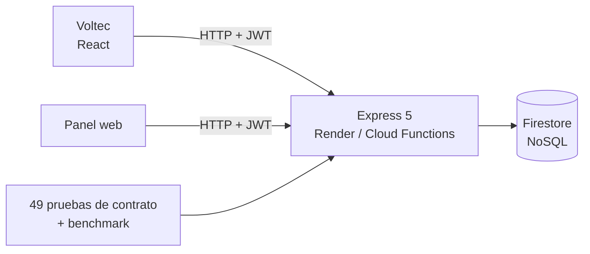
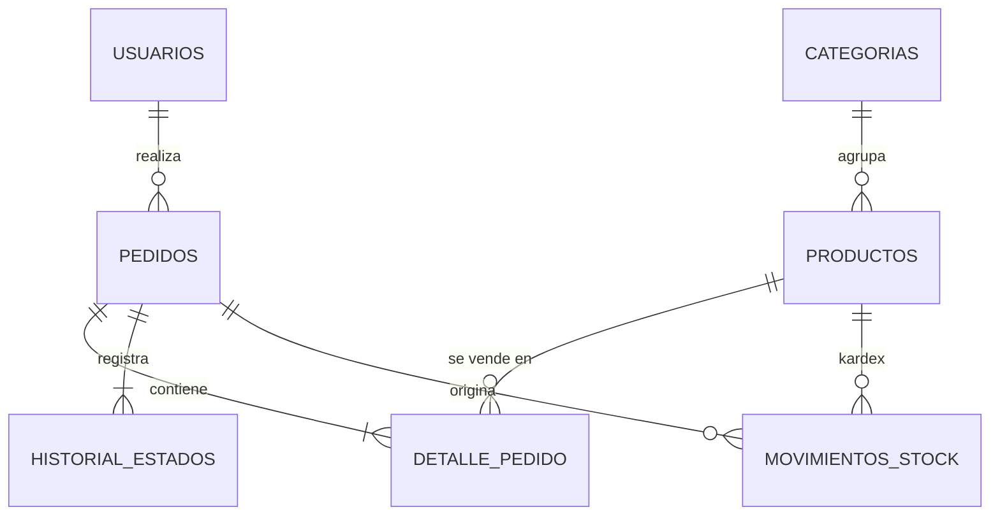

# 🛒 Tienda API — Express + Firebase

[](https://github.com/G2w1n/apis/actions/workflows/contrato.yml)

Sistema de **productos, pedidos y control de stock** hecho con **Node.js + Express 5** y **Firebase Firestore** (NoSQL),
publicado en Render.

Además, **[Voltec](frontend/)** es una tienda en **React** que consume esta API:
👉 **https://g2w1n-voltec.onrender.com**

Una batería de **49 pruebas de contrato** ([`tests/contrato.test.js`](tests/contrato.test.js)) comprueba cada regla de la API
en cada `push`.

Trabajo de la asignatura *Desarrollo de Aplicaciones Web* — Unidad 3: Frameworks de desarrollo Frontend y Backend.

---

## ¿Qué la hace diferente de un CRUD normal?

| Característica | Qué problema real resuelve |
|---|---|
| **Protección contra sobreventa** | 20 clientes compran a la vez un producto con 5 unidades → se aprueban **exactamente 5**. Se usan transacciones de Firestore con reintentos y una cola por producto. |
| **Idempotencia** (`Idempotency-Key`) | Si el cliente hace doble clic o la red reenvía la petición, **no se crea un pedido duplicado** ni se descuenta dos veces el stock. |
| **Kardex** | El stock **no se edita a mano**: solo cambia con movimientos (entrada/salida) que guardan el saldo resultante. Así siempre se sabe por qué cambió el stock. |
| **Máquina de estados** | `pendiente → pagado → enviado → entregado`. No se puede saltar de *pagado* a *entregado* ni cancelar algo ya entregado. |
| **Cancelación con devolución** | Cancelar un pedido devuelve el stock automáticamente y lo registra en el kardex. |
| **Dinero exacto** | En JS `0.1 + 0.2 = 0.30000000000000004`. Aquí se calcula con céntimos enteros. |
| **Foto del pedido** | El pedido guarda nombre y precio al momento de la compra: si mañana sube el precio, los pedidos antiguos no cambian. |
| **Borrado lógico** | Eliminar un producto lo oculta del catálogo, pero conserva el historial de pedidos y del kardex. |
| **Roles con JWT** | `admin` gestiona catálogo, stock y estados; `cliente` compra y ve **solo sus** pedidos (un pedido ajeno responde 404, no 403, para no revelar que existe). |
| **Errores uniformes** | La API responde siempre `{ "error": { "codigo", "mensaje", "detalles" } }` con su código HTTP. |
| **Benchmark** | Mide lecturas y pedidos concurrentes ([`docs/benchmark.md`](docs/benchmark.md)). |
| **Panel web** | Panel de pruebas con una demo de concurrencia en vivo. |
| **CI** | GitHub Actions ejecuta las 49 pruebas en cada `push` (con el emulador de Firestore) y compila el frontend. |
| **Anti fuerza bruta** | 5 logins fallidos para un email desde la misma IP lo bloquean 15 min (`429` + `Retry-After`). Se guarda en la base de datos para que valga en todas las instancias. |
| **Límite de peticiones** | Máximo `RATE_LIMIT_POR_MINUTO` (600 por defecto) peticiones por IP y minuto. |
| **CORS restringido** | Solo Voltec, el panel, Firebase Hosting y `localhost` pueden llamar a la API desde un navegador. |
| **Contraseñas fuertes** | Mayúscula, minúscula, número y símbolo; Voltec muestra un medidor en vivo. |
| **Auditoría** | Cada cambio de producto, stock, estado de pedido y cada bloqueo de login queda registrado (quién, qué, antes/después, IP, cuándo) **en la misma transacción** que el cambio. `GET /auditoria`. |
| **Swagger** | Documentación interactiva en `/docs`, generada desde un único [`shared/openapi.yaml`](shared/openapi.yaml). |
| **Imágenes** | Campo `imagen_url` validado (solo `http(s)` o rutas `/...`, nunca `javascript:`). |

## Arquitectura



Organización por capas: **rutas → validación (Zod) → servicio (lógica de negocio) → Firestore**.

### Modelo de datos



Como Firestore es NoSQL, los items y el historial van **embebidos** dentro del documento del pedido,
y el nombre de la categoría se **desnormaliza** dentro del producto. Así se evitan los *joins*, que Firestore no tiene.

---

## Contrato de la API (`/api/v1`)

| Método | Ruta | Acceso | Descripción |
|---|---|---|---|
| GET | `/health` | público | Estado, framework y base de datos |
| POST | `/auth/register` | público | Crea un cliente y devuelve `{ usuario, token }` |
| POST | `/auth/login` | público | Inicia sesión y devuelve `{ usuario, token }` |
| GET | `/auth/me` | autenticado | Usuario del token |
| GET | `/categorias` | público | Lista categorías |
| POST | `/categorias` | admin | Crea una categoría |
| GET | `/productos` | público | Catálogo con `q`, `categoria`, `precio_min`, `precio_max`, `bajo_stock`, `orden` (`precio`, `-precio`, `nombre`, `stock`, `creado`), `page`, `limit` |
| GET | `/productos/:id` | público | Detalle |
| POST | `/productos` | admin | Crea un producto (el stock inicial se registra en el kardex) |
| PUT/PATCH | `/productos/:id` | admin | Edita (el `stock` **no** se puede editar aquí) |
| DELETE | `/productos/:id` | admin | Borrado lógico |
| POST | `/pedidos` | autenticado | Crea un pedido y descuenta stock. Opcional: `envio` y `pago` (el servidor calcula el envío). Header opcional `Idempotency-Key` |
| GET | `/pedidos` | autenticado | Mis pedidos (admin: todos). Filtro `estado` |
| GET | `/pedidos/:id` | dueño o admin | Detalle con items e historial |
| PATCH | `/pedidos/:id/estado` | admin | Cambia el estado según la máquina de estados |
| POST | `/pedidos/:id/cancelar` | dueño o admin | Cancela y devuelve el stock |
| POST | `/stock/movimientos` | admin | Entrada o salida manual (`tipo`, `cantidad`, `motivo`) |
| GET | `/stock/movimientos` | admin | Kardex (`producto_id`, `tipo`) |
| GET | `/stock/alertas` | admin | Productos en o bajo su stock mínimo |
| GET | `/stock/reporte` | admin | Valor del inventario, ingresos, pedidos por estado, más vendidos |
| GET | `/envios/tarifas` | público | Distritos con cobertura, costo de envío (gratis desde S/ 500) y métodos de pago |
| GET | `/auditoria` | admin | Registro de cambios (`entidad`, `entidad_id`, `accion`) |
| GET | `/docs` (raíz) | público | Documentación Swagger interactiva |

<details>
<summary><b>Ejemplo: crear un pedido</b></summary>

```http
POST /api/v1/pedidos
Authorization: Bearer <token>
Idempotency-Key: 7f9c2b1e-...
Content-Type: application/json

{ "items": [ { "producto_id": 1, "cantidad": 2 }, { "producto_id": 5, "cantidad": 1 } ] }
```

`201 Created`
```json
{
  "id": 42, "usuario_id": 2, "estado": "pendiente", "total": 7048.80,
  "items": [
    { "producto_id": 1, "sku": "LAP-001", "nombre": "Laptop Lenovo IdeaPad 5", "cantidad": 2, "precio_unitario": 3299.9, "subtotal": 6599.8 },
    { "producto_id": 5, "sku": "ACC-001", "nombre": "Mouse Logitech MX Master 3S", "cantidad": 1, "precio_unitario": 449.0, "subtotal": 449.0 }
  ],
  "historial": [ { "estado": "pendiente", "fecha": "2026-10-26T01:21:42.358Z" } ],
  "created_at": "2026-10-26T01:21:42.358Z"
}
```

Sin stock suficiente → `409 Conflict`
```json
{
  "error": {
    "codigo": "STOCK_INSUFICIENTE",
    "mensaje": "No hay stock suficiente",
    "detalles": [ { "producto_id": 7, "nombre": "iPhone 15", "solicitado": 4, "disponible": 2 } ]
  }
}
```
</details>

**Códigos de error:** `VALIDACION` (400), `JSON_INVALIDO` (400), `NO_AUTENTICADO` (401), `CREDENCIALES_INVALIDAS` (401),
`PROHIBIDO` (403), `DEMASIADOS_INTENTOS` / `LIMITE_PETICIONES` (429), `NO_ENCONTRADO` / `RUTA_NO_ENCONTRADA` (404), `EMAIL_EN_USO` / `SKU_DUPLICADO` / `CATEGORIA_DUPLICADA` /
`STOCK_INSUFICIENTE` / `CONFLICTO_CONCURRENCIA` (409), `PRODUCTO_NO_DISPONIBLE` / `TRANSICION_INVALIDA` / `CATEGORIA_INVALIDA` (422).

**Usuarios de prueba** (los crea el seed, [`shared/seed.json`](shared/seed.json)):

| Rol | Email | Contraseña |
|---|---|---|
| admin | `admin@tienda.pe` | `Admin123*` |
| cliente | `cliente@tienda.pe` | `Cliente123*` |

---

## Cómo ejecutarlo

**Requisitos:** Node.js 22 y Java 21 (para el emulador de Firebase).

```bash
git clone https://github.com/G2w1n/apis.git && cd apis
npm install -g firebase-tools
cd node-firebase/functions && npm install
firebase emulators:start --only firestore --project demo-tienda   # en otra terminal; consola: http://localhost:4000
export FIRESTORE_EMULATOR_HOST=127.0.0.1:8080
npm run seed && npm start                                         # API en http://localhost:3000/api/v1
```

Voltec en local: `cd frontend && npm install && npm run dev` (usa la API local de `localhost:3000`).

### Pruebas, benchmark y panel
```bash
npm run test:express     # 49 pruebas de contrato
npm run benchmark        # mide la API y actualiza docs/benchmark.md
                         # (arranca la API con RATE_LIMIT_POR_MINUTO=100000 para que el límite no corte la medición)
```
Para el panel, abre `node-firebase/public/index.html` (o `npm run emuladores` en `node-firebase/functions` y entra a http://localhost:5000),
y entra como admin.

### Probar con Postman
En [`postman/`](postman/) está la colección con los 31 endpoints de ejemplo (con pruebas automáticas) y dos entornos:
1. En Postman: **Import** → arrastra los 3 archivos de la carpeta `postman/`.
2. Arriba a la derecha elige el entorno **Voltec — Render** (nube) o **Voltec — Local**.
3. Ejecuta **Auth → Login admin** y **Login cliente** (guardan los tokens solos) y luego **Productos → Listar productos**.
4. O usa **Run collection** para correr todo en orden.

### Publicar en la nube con Render (gratis)
El archivo [`render.yaml`](render.yaml) crea todo de una vez: la API, el panel y Voltec.

1. Entra a https://render.com y regístrate con tu cuenta de **GitHub**.
2. **New → Blueprint** → elige el repositorio `G2w1n/apis` → **Apply**.
3. Render te pedirá la variable `FIREBASE_SERVICE_ACCOUNT` de la API: en la consola de Firebase ve a
   ⚙️ Configuración del proyecto → **Cuentas de servicio → Generar nueva clave privada**, abre el archivo descargado
   y pega **todo su contenido**.
4. Espera a que los 3 servicios queden en verde (el primer despliegue tarda unos minutos). La API carga sola los datos de ejemplo si Firestore está vacío.

| Servicio | URL |
|---|---|
| **Voltec (tienda en React)** | https://g2w1n-voltec.onrender.com |
| Panel web de pruebas | https://g2w1n-tienda-panel.onrender.com |
| API (Express + Firestore) | https://g2w1n-tienda-express.onrender.com/api/v1/productos |
| Documentación Swagger | https://g2w1n-tienda-express.onrender.com/docs |

> Si Render asigna otra URL (cuando el nombre ya está ocupado), actualízala en `BACKENDS` dentro de `node-firebase/public/index.html` y `frontend/src/context/ApiContext.jsx`.
> En el plan gratuito los servicios se "duermen" tras 15 min sin uso: la primera visita tarda ~1 min. Ábrelos unos minutos
> antes de exponer.

### Desplegar en Firebase (proyecto `probandoapi-8c9b8`)
El repositorio ya apunta al proyecto `probandoapi-8c9b8` (`node-firebase/.firebaserc`). Cloud Functions y Firestore usan la
región **southamerica-east1** (São Paulo).

**Con plan Blaze** (API + panel en la nube):
```bash
cd node-firebase
firebase login
cp functions/.env.example functions/.env    # cambia JWT_SECRET por un texto largo y aleatorio
firebase deploy --only functions,hosting,firestore
```
- Panel: https://probandoapi-8c9b8.web.app
- API: https://probandoapi-8c9b8.web.app/api/v1/health

**Sin Blaze** (plan Spark: Firestore real + panel en Hosting; la API corre en tu PC):
```bash
cd node-firebase
firebase login
firebase deploy --only hosting,firestore
# Consola de Firebase → ⚙️ Configuración → Cuentas de servicio → "Generar nueva clave privada"
# guarda el archivo como node-firebase/functions/serviceAccount.json (está en .gitignore: NUNCA lo subas)
cd functions && npm install && npm start    # API en http://localhost:3000/api/v1 usando tu Firestore real
```

**Cargar los datos de ejemplo en Firestore real** (borra lo que haya en esas colecciones):
con `functions/serviceAccount.json` presente y **sin** la variable `FIRESTORE_EMULATOR_HOST`, ejecuta `npm run seed` en `node-firebase/functions`.

---

## Decisiones técnicas

| | Express + Firestore |
|---|---|
| Lenguaje | JavaScript (Node.js 22) |
| Estilo | Minimalista: se elige cada pieza (Zod, helmet, express-rate-limit, JWT) |
| Validación | Zod (esquemas) |
| Acceso a datos | SDK de Firebase Admin (documentos) |
| Anti-sobreventa | Transacción optimista + reintentos + cola por producto |
| Filtros y búsqueda | En memoria (Firestore no tiene `LIKE` ni varios rangos por consulta) |
| Despliegue | Render (gratis) o Cloud Functions + Hosting de Firebase |

Rendimiento medido con [`tests/benchmark.js`](tests/benchmark.js) (Firestore en emulador local); ver [`docs/benchmark.md`](docs/benchmark.md).

### Lecciones aprendidas
1. **Concurrencia en NoSQL.** Firestore usa transacciones optimistas: si dos compras chocan, una se reintenta. Con 20 compras
   simultáneas del **mismo** producto (un "documento caliente"), la primera versión bajó a **2 pedidos/s con p95 de 73 s**.
   Al encolar en la API las operaciones sobre el mismo producto subió a **~150 pedidos/s**, sin perder la garantía de la
   transacción, y el stock final fue exacto.
2. **Firestore no es una base de datos relacional.** No hay `JOIN`, `LIKE` ni `UNIQUE`. Se reemplazaron con
   desnormalización, filtros en memoria y documentos "candado" (`_unicos/sku:LAP-001`) creados dentro de la transacción.
3. **El diseño importa más que la herramienta.** Lo que evita errores graves (sobreventa, cobros duplicados, totales mal
   redondeados) son decisiones de diseño: transacciones, idempotencia, kardex y céntimos enteros.

---

## Estructura del repositorio

```
apis/
├── frontend/               Voltec: tienda en React + Vite + Tailwind
├── node-firebase/          API Express + Firestore (functions/) y panel web (public/)
├── shared/                 seed.json (datos de ejemplo), openapi.yaml (Swagger), envios.json
├── postman/               Colección y entornos de Postman
├── tests/
│   ├── contrato.test.js    49 pruebas de contrato
│   └── benchmark.js        Medición de rendimiento
├── docs/benchmark.md       Últimos resultados
└── .github/workflows/      CI: pruebas de contrato en cada push
```

## Guion sugerido para la demo (≈5 min)
1. **Voltec → Catálogo:** buscar con Ctrl+K, filtrar y comparar productos.
2. **Comprar** dos productos; hacer doble clic en *Confirmar* → la respuesta dice "ya registrado" (idempotencia).
3. Intentar comprar más de lo que hay → error `STOCK_INSUFICIENTE` con el detalle.
4. **Pedidos:** marcar pagado → enviado → entregado; intentar cancelar un pedido entregado → no se permite.
5. **Stock y kardex:** ver cómo cada venta y cada cancelación quedan registradas con su saldo.
6. **⚡ Demo concurrencia:** 20 compras simultáneas con stock 5 → 5 verdes y 15 rojas, stock final 0.
7. Mostrar **GitHub Actions** en verde: las 49 pruebas pasan en cada `push`.
