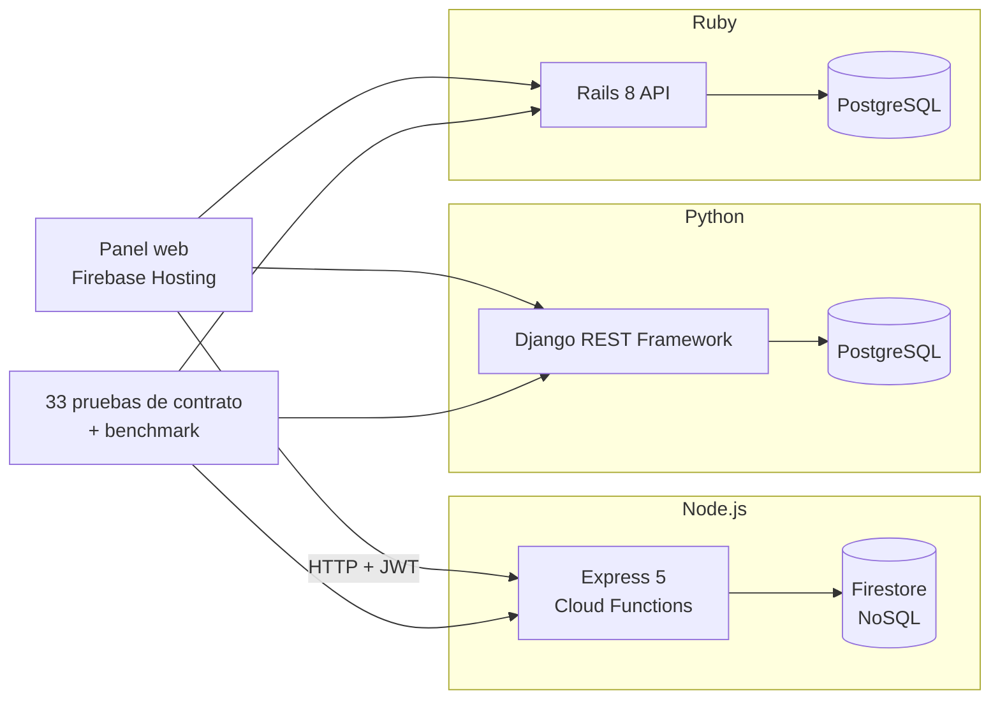
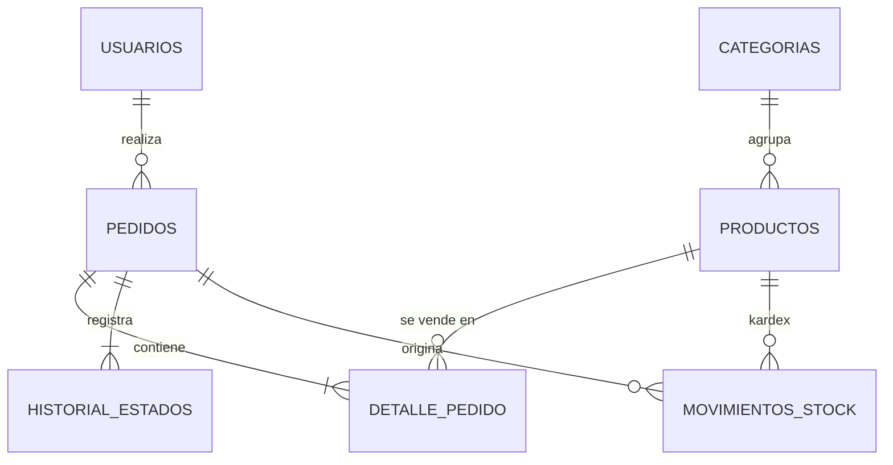

# 🛒 Tienda API — el mismo backend en 3 frameworks

[](https://github.com/G2w1n/apis/actions/workflows/contrato.yml)

Sistema de **productos, pedidos y control de stock** construido **tres veces**, con el mismo contrato HTTP:

| Carpeta | Framework | Base de datos | Puerto local |
|---|---|---|---|
| [`node-firebase/`](node-firebase/) | **Node.js + Express 5** (Cloud Functions) | **Firebase Firestore** (NoSQL) | 3000 |
| [`django/`](django/) | **Django 5 + Django REST Framework** | **PostgreSQL** (SQL) | 8000 |
| [`rails/`](rails/) | **Ruby on Rails 8** (modo API) | **PostgreSQL** (SQL) | 3001 |

Además, **[Voltec](frontend/)** es una tienda en **React** que consume cualquiera de las 3 APIs (se cambia en vivo):
👉 **https://g2w1n-voltec.onrender.com**

Una **única batería de 33 pruebas** ([`tests/contrato.test.js`](tests/contrato.test.js)) se ejecuta contra las tres
y las tres la pasan. Así, la comparación entre frameworks se basa en código que hace exactamente lo mismo, no en opiniones.

Trabajo de la asignatura *Desarrollo de Aplicaciones Web* — Unidad 3: Frameworks de desarrollo Frontend y Backend.

---

## ¿Qué la hace diferente de un CRUD normal?

| Característica | Qué problema real resuelve |
|---|---|
| **Protección contra sobreventa** | 20 clientes compran a la vez un producto con 5 unidades → se aprueban **exactamente 5**. Se usan transacciones y bloqueo de filas (SQL) o transacciones optimistas (Firestore). |
| **Idempotencia** (`Idempotency-Key`) | Si el cliente hace doble clic o la red reenvía la petición, **no se crea un pedido duplicado** ni se descuenta dos veces el stock. |
| **Kardex** | El stock **no se edita a mano**: solo cambia con movimientos (entrada/salida) que guardan el saldo resultante. Así siempre se sabe por qué cambió el stock. |
| **Máquina de estados** | `pendiente → pagado → enviado → entregado`. No se puede saltar de *pagado* a *entregado* ni cancelar algo ya entregado. |
| **Cancelación con devolución** | Cancelar un pedido devuelve el stock automáticamente y lo registra en el kardex. |
| **Dinero exacto** | En JS `0.1 + 0.2 = 0.30000000000000004`. Aquí se usan céntimos enteros (Node) y `Decimal` / `BigDecimal` (Python/Ruby). |
| **Foto del pedido** | El pedido guarda nombre y precio al momento de la compra: si mañana sube el precio, los pedidos antiguos no cambian. |
| **Borrado lógico** | Eliminar un producto lo oculta del catálogo, pero conserva el historial de pedidos y del kardex. |
| **Roles con JWT** | `admin` gestiona catálogo, stock y estados; `cliente` compra y ve **solo sus** pedidos (un pedido ajeno responde 404, no 403, para no revelar que existe). |
| **Errores uniformes** | Todas las APIs responden `{ "error": { "codigo", "mensaje", "detalles" } }` con el mismo código HTTP. |
| **Benchmark** | Mide lecturas y pedidos concurrentes en las tres APIs con la misma carga ([`docs/benchmark.md`](docs/benchmark.md)). |
| **Panel web** | Frontend en Firebase Hosting que funciona con **cualquiera** de las 3 APIs, con una demo de concurrencia en vivo. |
| **CI** | GitHub Actions ejecuta las 33 pruebas contra las 3 APIs en cada `push`. |

## Arquitectura



Las tres siguen la misma organización por capas: **rutas → validación → servicio (lógica de negocio) → base de datos**.

### Modelo de datos



En **Firestore** (NoSQL) el modelo cambia: los items y el historial van **embebidos** dentro del documento del pedido,
y el nombre de la categoría se **desnormaliza** dentro del producto. Así se evitan los *joins*, que Firestore no tiene.

---

## Contrato de la API (`/api/v1`)

| Método | Ruta | Acceso | Descripción |
|---|---|---|---|
| GET | `/health` | público | Estado, framework y base de datos |
| POST | `/auth/register` | público | Crea un cliente y devuelve `{ usuario, token }` |
| POST | `/auth/login` | público | Inicia sesión y devuelve `{ usuario, token }` |
| GET | `/auth/me` | autenticado | Usuario del token |
| GET | `/categorias` | público | Lista categorías |
| POST | `/categorias` | admin | Crea una categoría |
| GET | `/productos` | público | Catálogo con `q`, `categoria`, `precio_min`, `precio_max`, `bajo_stock`, `orden` (`precio`, `-precio`, `nombre`, `stock`, `creado`), `page`, `limit` |
| GET | `/productos/:id` | público | Detalle |
| POST | `/productos` | admin | Crea un producto (el stock inicial se registra en el kardex) |
| PUT/PATCH | `/productos/:id` | admin | Edita (el `stock` **no** se puede editar aquí) |
| DELETE | `/productos/:id` | admin | Borrado lógico |
| POST | `/pedidos` | autenticado | Crea un pedido y descuenta stock. Header opcional `Idempotency-Key` |
| GET | `/pedidos` | autenticado | Mis pedidos (admin: todos). Filtro `estado` |
| GET | `/pedidos/:id` | dueño o admin | Detalle con items e historial |
| PATCH | `/pedidos/:id/estado` | admin | Cambia el estado según la máquina de estados |
| POST | `/pedidos/:id/cancelar` | dueño o admin | Cancela y devuelve el stock |
| POST | `/stock/movimientos` | admin | Entrada o salida manual (`tipo`, `cantidad`, `motivo`) |
| GET | `/stock/movimientos` | admin | Kardex (`producto_id`, `tipo`) |
| GET | `/stock/alertas` | admin | Productos en o bajo su stock mínimo |
| GET | `/stock/reporte` | admin | Valor del inventario, ingresos, pedidos por estado, más vendidos |

<details>
<summary><b>Ejemplo: crear un pedido</b></summary>

```http
POST /api/v1/pedidos
Authorization: Bearer <token>
Idempotency-Key: 7f9c2b1e-...
Content-Type: application/json

{ "items": [ { "producto_id": 1, "cantidad": 2 }, { "producto_id": 5, "cantidad": 1 } ] }
```

`201 Created`
```json
{
  "id": 42, "usuario_id": 2, "estado": "pendiente", "total": 7048.80,
  "items": [
    { "producto_id": 1, "sku": "LAP-001", "nombre": "Laptop Lenovo IdeaPad 5", "cantidad": 2, "precio_unitario": 3299.9, "subtotal": 6599.8 },
    { "producto_id": 5, "sku": "ACC-001", "nombre": "Mouse Logitech MX Master 3S", "cantidad": 1, "precio_unitario": 449.0, "subtotal": 449.0 }
  ],
  "historial": [ { "estado": "pendiente", "fecha": "2026-10-26T01:21:42.358Z" } ],
  "created_at": "2026-10-26T01:21:42.358Z"
}
```

Sin stock suficiente → `409 Conflict`
```json
{
  "error": {
    "codigo": "STOCK_INSUFICIENTE",
    "mensaje": "No hay stock suficiente",
    "detalles": [ { "producto_id": 7, "nombre": "iPhone 15", "solicitado": 4, "disponible": 2 } ]
  }
}
```
</details>

**Códigos de error:** `VALIDACION` (400), `JSON_INVALIDO` (400), `NO_AUTENTICADO` (401), `CREDENCIALES_INVALIDAS` (401),
`PROHIBIDO` (403), `NO_ENCONTRADO` / `RUTA_NO_ENCONTRADA` (404), `EMAIL_EN_USO` / `SKU_DUPLICADO` / `CATEGORIA_DUPLICADA` /
`STOCK_INSUFICIENTE` / `CONFLICTO_CONCURRENCIA` (409), `PRODUCTO_NO_DISPONIBLE` / `TRANSICION_INVALIDA` / `CATEGORIA_INVALIDA` (422).

**Usuarios de prueba** (los crea el seed, [`shared/seed.json`](shared/seed.json)):

| Rol | Email | Contraseña |
|---|---|---|
| admin | `admin@tienda.pe` | `Admin123*` |
| cliente | `cliente@tienda.pe` | `Cliente123*` |

---

## Cómo ejecutarlo

**Requisitos:** Node.js 22, Java 21 (para el emulador de Firebase), Python 3.12+, Ruby 3.3 y PostgreSQL 16
(o Docker para levantar PostgreSQL con `docker compose up -d`).

```bash
git clone https://github.com/G2w1n/apis.git && cd apis
docker compose up -d          # PostgreSQL con las bases tienda_django y tienda_rails (opcional si ya tienes PostgreSQL)
```

### 1. Express + Firebase (puerto 3000)
```bash
npm install -g firebase-tools
cd node-firebase/functions && npm install
firebase emulators:start --only firestore --project demo-tienda   # en otra terminal; consola: http://localhost:4000
export FIRESTORE_EMULATOR_HOST=127.0.0.1:8080
npm run seed && npm start
```

### 2. Django (puerto 8000)
```bash
cd django
python -m venv .venv && source .venv/bin/activate   # Windows: .venv\Scripts\activate
pip install -r requirements.txt
python manage.py migrate && python manage.py seed
python manage.py runserver 8000                     # panel admin en http://localhost:8000/admin/
```

### 3. Rails (puerto 3001)
```bash
cd rails
bundle install
bin/rails db:prepare db:seed
bin/rails server -p 3001
```

### Pruebas, benchmark y panel
```bash
npm run test:express     # o test:django / test:rails  → 33 pruebas
npm run benchmark        # compara las 3 APIs y actualiza docs/benchmark.md
```
Para el panel, abre `node-firebase/public/index.html` (o `npm run emuladores` en `node-firebase/functions` y entra a http://localhost:5000),
elige la API en el selector superior y entra como admin.

### Publicar en la nube con Render (gratis)
El archivo [`render.yaml`](render.yaml) crea todo de una vez: las 3 APIs, el panel y la base PostgreSQL.

1. Entra a https://render.com y regístrate con tu cuenta de **GitHub**.
2. **New → Blueprint** → elige el repositorio `G2w1n/apis` → **Apply**.
3. Render te pedirá la variable `FIREBASE_SERVICE_ACCOUNT` de la API Express: en la consola de Firebase ve a
   ⚙️ Configuración del proyecto → **Cuentas de servicio → Generar nueva clave privada**, abre el archivo descargado
   y pega **todo su contenido**.
4. Espera a que los 4 servicios queden en verde (el primer despliegue tarda unos minutos). Cada API carga sola los datos de ejemplo.

| Servicio | URL |
|---|---|
| **Voltec (tienda en React)** | https://g2w1n-voltec.onrender.com |
| Panel web de pruebas | https://g2w1n-tienda-panel.onrender.com |
| Express + Firestore | https://g2w1n-tienda-express.onrender.com/api/v1/productos |
| Django + PostgreSQL | https://g2w1n-tienda-django.onrender.com/api/v1/productos · admin: `/admin/` |
| Rails + PostgreSQL | https://g2w1n-tienda-rails.onrender.com/api/v1/productos |

> Si Render asigna otra URL (cuando el nombre ya está ocupado), actualízala en `BACKENDS` dentro de `node-firebase/public/index.html`.
> En el plan gratuito los servicios se "duermen" tras 15 min sin uso: la primera visita tarda ~1 min. Ábrelos unos minutos
> antes de exponer. La base PostgreSQL gratuita de Render caduca a los 30 días.

### Desplegar en Firebase (proyecto `probandoapi-8c9b8`)
El repositorio ya apunta al proyecto `probandoapi-8c9b8` (`node-firebase/.firebaserc`). Cloud Functions y Firestore usan la
región **southamerica-east1** (São Paulo).

**Con plan Blaze** (API + panel en la nube):
```bash
cd node-firebase
firebase login
cp functions/.env.example functions/.env    # cambia JWT_SECRET por un texto largo y aleatorio
firebase deploy --only functions,hosting,firestore
```
- Panel: https://probandoapi-8c9b8.web.app
- API: https://probandoapi-8c9b8.web.app/api/v1/health

**Sin Blaze** (plan Spark: Firestore real + panel en Hosting; la API corre en tu PC):
```bash
cd node-firebase
firebase login
firebase deploy --only hosting,firestore
# Consola de Firebase → ⚙️ Configuración → Cuentas de servicio → "Generar nueva clave privada"
# guarda el archivo como node-firebase/functions/serviceAccount.json (está en .gitignore: NUNCA lo subas)
cd functions && npm install && npm start    # API en http://localhost:3000/api/v1 usando tu Firestore real
```

**Cargar los datos de ejemplo en Firestore real** (borra lo que haya en esas colecciones):
con `functions/serviceAccount.json` presente y **sin** la variable `FIRESTORE_EMULATOR_HOST`, ejecuta `npm run seed` en `node-firebase/functions`.

---

## Comparativa basada en este proyecto

| | Express + Firestore | Django + PostgreSQL | Rails + PostgreSQL |
|---|---|---|---|
| Lenguaje | JavaScript | Python | Ruby |
| Estilo | Minimalista: eliges cada pieza | "Baterías incluidas" | "Convención sobre configuración" |
| Líneas de código* | ~670 | ~780 (incluye panel admin) | ~620 |
| Validación | Zod (esquemas) | Serializers de DRF | Validador propio (Rails convierte `1.5` → `1` sin avisar) |
| Acceso a datos | SDK de Firestore (documentos) | ORM de Django | Active Record |
| Migraciones | No aplica (sin esquema) | Automáticas (`makemigrations`) | Migraciones en Ruby |
| Anti-sobreventa | Transacción optimista + reintentos + cola por producto | `select_for_update()` + `CHECK (stock >= 0)` | `.lock` (FOR UPDATE) + `CHECK (stock >= 0)` |
| Filtros y búsqueda | En memoria (Firestore no tiene `LIKE` ni varios rangos por consulta) | SQL (`ILIKE`, `WHERE`, `ORDER BY`) | SQL (`ILIKE`, `WHERE`, `ORDER BY`) |
| Reportes | Recorre documentos en el código | Agregaciones SQL (`SUM`, `GROUP BY`) | Agregaciones SQL |
| Extra gratis | Hosting + despliegue serverless | Panel `/admin/` sin escribir frontend | Generadores y convenciones |
| Lecturas (req/s) | 268 | 684 | 416 |
| Pedidos concurrentes (req/s) | 154 | 149 | 101 |

\* Sin contar líneas vacías ni comentarios. Rendimiento medido en la misma máquina con [`tests/benchmark.js`](tests/benchmark.js)
(Firestore en emulador local); ver [`docs/benchmark.md`](docs/benchmark.md).

### Lecciones aprendidas
1. **SQL vs NoSQL para inventario.** PostgreSQL resuelve la concurrencia bloqueando la fila: la segunda compra espera.
   Firestore usa transacciones optimistas: si dos chocan, una se reintenta. Con 20 compras simultáneas del **mismo**
   producto (un "documento caliente"), la primera versión en Firestore bajó a **2 pedidos/s con p95 de 73 s**.
   Al encolar en la API las operaciones sobre el mismo producto subió a **~150 pedidos/s**, sin perder la garantía de la
   transacción. En los tres casos el stock final fue exacto.
2. **Firestore no es una base de datos relacional.** No hay `JOIN`, `LIKE` ni `UNIQUE`. Se reemplazaron con
   desnormalización, filtros en memoria y documentos "candado" (`_unicos/sku:LAP-001`) creados dentro de la transacción.
3. **El framework importa menos que el diseño.** Las tres APIs pasan las mismas 33 pruebas. Lo que evita errores graves
   (sobreventa, cobros duplicados, totales mal redondeados) son las decisiones de diseño, no el lenguaje.
4. **Cada framework brilla en algo:** Express + Firebase en despliegue y escalado sin servidores; Django en tener panel
   de administración y ORM listos; Rails en lo poco que hay que escribir gracias a sus convenciones.

---

## Estructura del repositorio

```
apis/
├── frontend/               Voltec: tienda en React + Vite + Tailwind
├── node-firebase/          Express + Firestore (Cloud Functions) y panel web (public/)
├── django/                 Django + DRF + PostgreSQL
├── rails/                  Rails 8 API + PostgreSQL
├── shared/seed.json        Mismos datos de ejemplo para las 3 APIs
├── tests/
│   ├── contrato.test.js    33 pruebas que deben pasar las 3 APIs
│   └── benchmark.js        Comparación de rendimiento
├── docs/benchmark.md       Últimos resultados
├── docker-compose.yml      PostgreSQL para Django y Rails
└── .github/workflows/      CI: pruebas de contrato en cada push
```

## Guion sugerido para la demo (≈5 min)
1. **Panel → Catálogo:** cambiar entre Express, Django y Rails en el selector. Los mismos datos y el mismo comportamiento.
2. **Comprar** dos productos; hacer doble clic en *Confirmar* → la respuesta dice "ya registrado" (idempotencia).
3. Intentar comprar más de lo que hay → error `STOCK_INSUFICIENTE` con el detalle.
4. **Pedidos:** marcar pagado → enviado → entregado; intentar cancelar un pedido entregado → no se permite.
5. **Stock y kardex:** ver cómo cada venta y cada cancelación quedan registradas con su saldo.
6. **⚡ Demo concurrencia:** 20 compras simultáneas con stock 5 → 5 verdes y 15 rojas, stock final 0.
7. Mostrar **GitHub Actions** en verde: las 3 APIs pasan las mismas pruebas.
